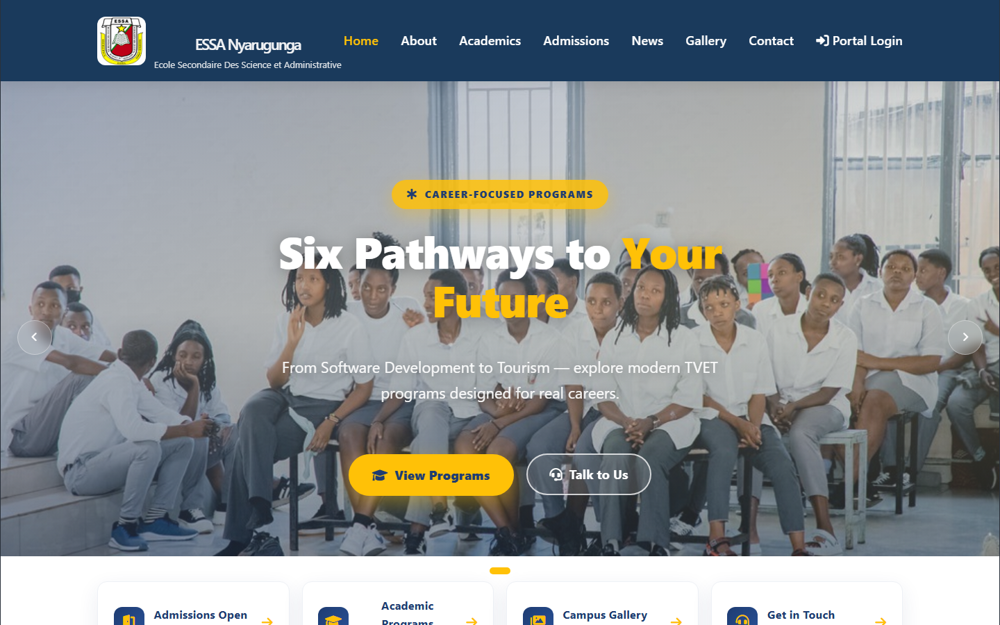
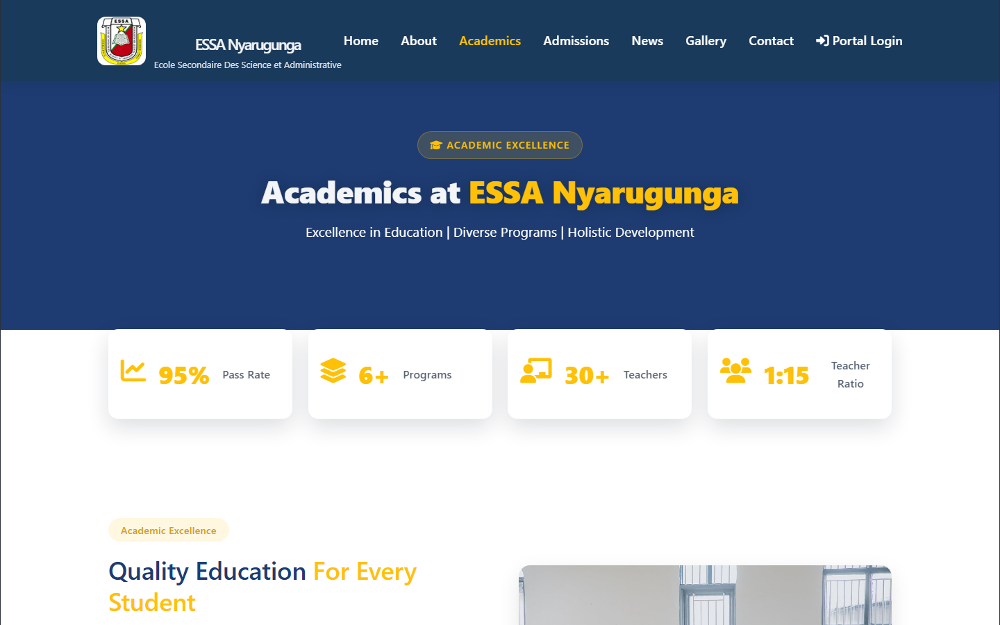
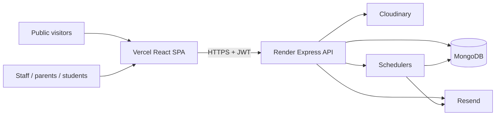

<div align="center">

# ESSA Nyarugunga School Management System

**A public school website and a secure eight-role administration portal in one platform.**

[Live Website](https://essa-nyarugunga-school-complex-syst-eta.vercel.app/) · [API Status](https://essa-api.onrender.com/api/health) · [Report an Issue](https://github.com/Kevin-The-Cyber-Coder/essa-nyarugunga-sms/issues)

[](https://github.com/Kevin-The-Cyber-Coder/essa-nyarugunga-sms/actions/workflows/ci.yml)
[](https://essa-nyarugunga-school-complex-syst-eta.vercel.app/)
[](https://essa-api.onrender.com/api/health)
[](frontend)
[](backend)
[](backend)

</div>

---

## Table of Contents

- [Overview](#overview)
- [Live deployment](#live-deployment)
- [Screenshots](#screenshots)
- [Core capabilities](#core-capabilities)
- [Roles and access](#roles-and-access)
- [Architecture](#architecture)
- [Technology stack](#technology-stack)
- [Repository structure](#repository-structure)
- [Environment configuration](#environment-configuration)
- [Local development](#local-development)
- [Database reset](#database-reset)
- [Deployment](#deployment)
- [API at a glance](#api-at-a-glance)
- [Verification](#verification)
- [Security](#security)
- [Documentation](#documentation)
- [Contributing](#contributing)
- [License](#license)

---

## Overview

**ESSA Nyarugunga School Management System** is a full-stack platform built for ESSA Nyarugunga, a TVET school in Kigali, Rwanda. It combines the school's public-facing website with the internal workflows staff need to run admissions, academics, discipline, finance, registration, communication and website publishing.

The project is intentionally **essentials-only**. It focuses on the workflows the school actually needs instead of accumulating disconnected features. The current scope excludes quizzes, attendance, timetables, lesson plans, analytics dashboards, calendars/events, report cards, promotion/enrollment workflows, SDMS codes, permission slips, subscriptions/newsletters, chat, push notifications, SMS, payroll and parent online payments.

The result is a smaller, clearer system with a strong security boundary: the frontend hides irrelevant navigation, but **every privileged action is enforced again on the backend**.

### Design goals

- **One system, two surfaces** — a public website and eight private role portals.
- **Server-enforced access control** — role checks are never trusted to the browser.
- **Clear data ownership** — teachers, parents and students only see records they are entitled to.
- **Practical workflows** — admissions, results, fees, discipline and communication stay connected.
- **Production-ready delivery** — Vercel frontend, Render API, MongoDB, Cloudinary and Resend.

---

## Live deployment

| Service | URL | Purpose |
| --- | --- | --- |
| **Frontend** | <https://essa-nyarugunga-school-complex-syst-eta.vercel.app/> | Public website and role portals |
| **Backend API** | <https://essa-api.onrender.com/> | REST API |
| **API health** | <https://essa-api.onrender.com/api/health> | Lightweight deployment check |

The frontend is built with Vite and deployed on Vercel. The API is an Express service on Render. Production builds resolve the API base from `frontend/src/config/api.js`; a stale `VITE_API_URL` pointing at localhost is ignored in production.

---

## Screenshots

Real captures from the running application:

| Public website | Portal sign-in |
| --- | --- |
|  |  |

| About ESSA | Academic programmes |
| --- | --- |
|  |  |

| Admissions | News |
| --- | --- |
|  |  |

### Headmaster portal


---

## Core capabilities

### Public website

- Responsive home, about, academics, admissions, news, gallery and contact pages.
- Online admission application with duplicate detection.
- Published news and gallery content only; drafts and scheduled items stay private.
- Privacy, terms, accessibility, sitemap and search pages.

### Admissions

- Public application submission.
- Duplicate detection by email, phone and verified national/ID number.
- Status flow: `submitted` → `under_review` → `approved` / `rejected` → `registered`.
- `registered` is only reachable through the dedicated registration endpoint after approval.
- Admin Assistants review and register; the Headmaster makes final approval and rejection decisions.

### Academics and results

- Teachers enter marks for assigned classes and subjects.
- Academic Administrators review and publish final results.
- Students and parents only see records they are authorized to see.
- Assignments, class resources and class announcements remain available to teachers.

### Finance and discipline

- Accounts Administrators manage fee structures, invoices, payments, expenses and budgets.
- Discipline Administrators record cases, follow up on conduct and notify parents.
- Finance, exam, discipline and admissions duties stay separated by role.

### Website content management

There is no standalone CMS route. The shared content editor is embedded only in dashboards whose role is authorized to manage content.

- Categories: `academic`, `discipline`, `financial`, `general`.
- Lifecycle: `draft` → `scheduled` → `published`.
- Scheduled items become public automatically when their publish time arrives.
- Category ownership is checked on the backend before create, edit, delete or status changes.

### Notifications and uploads

- Delivery channels: **in-app notifications and email only**.
- Resend provides transactional email; no SMS, push or chat provider is used.
- Every message uses one responsive, branded template with a plain-text alternative: account invitations, password changes, admission receipts and decisions, contact confirmations and portal notifications.
- Sub-admin invitations carry a single-use, 24-hour password link. The Headmaster can resend it from the admin table; the generated password is never emailed.
- Cloudinary stores uploaded images and files in production, with local disk as a development fallback.
- Uploaded news/gallery images, profile photos, assignment files, submissions and class resources all share one storage adapter.

---

## Roles and access

| Role | Portal route | Primary responsibilities |
| --- | --- | --- |
| Headmaster | `/portal/headmaster` | Final admission decisions, staff oversight, whole-school visibility, announcements |
| Academic Administrator | `/portal/academic-admin` | Classes, subjects, teacher allocation, exams, final result review and publication |
| Discipline Administrator | `/portal/discipline-admin` | Discipline records, conduct follow-up and parent notification |
| Accounts Administrator | `/portal/accounts-admin` | Fee structures, invoices, payments, expenses and budgets |
| Admin Assistant | `/portal/admin-assistant` | Application review, registration, student/parent/staff records, documents |
| Teacher | `/portal/teacher` | Enter marks for assigned subjects/classes, assignments, resources and class notices |
| Parent | `/portal/parent` | View only linked and verified children's grades, fees, discipline and documents |
| Student | `/portal/student` | View only their own grades, fees, assignments and announcements |

`super_admin` remains as a compatibility alias for `headmaster` in both role configurations. It is not a ninth role.

### Access boundaries

- **Teachers** are scoped by class and subject allocation.
- **Parents** are scoped to linked, verified children.
- **Students** are scoped to their own records.
- **Finance, exam, discipline, admissions and registration duties** stay separated by role.
- **Hidden navigation is not security.** Every protected API route checks the authenticated user's role again.

---

## Architecture



### Request flow

1. The React SPA loads from Vercel and calls the Render API using `VITE_API_URL`.
2. Protected requests carry a JWT; backend middleware authenticates the token and checks the required role.
3. Role-scoped route handlers apply ownership rules before reading or writing data.
4. Uploaded files are sent to the shared storage adapter and stored in Cloudinary in production.
5. In-app notifications are written to MongoDB; email notifications are delivered through Resend.
6. Schedulers publish due content, release scheduled announcements and send assignment/exam reminders.

More detail: [docs/ARCHITECTURE.md](docs/ARCHITECTURE.md).

---

## Technology stack

| Layer | Technology |
| --- | --- |
| Frontend | React 19, Vite 8, React Router 7, Axios, SweetAlert2 |
| Backend | Node.js 20+, Express 4, MongoDB, Mongoose 7 |
| Authentication | JWT, bcryptjs, backend role middleware |
| Uploads | Multer memory storage, Cloudinary, local-disk fallback |
| Email | Resend |
| Hosting | Vercel (frontend), Render (API) |
| Database | MongoDB / MongoDB Atlas |

---

## Repository structure

```text
backend/
  config/          Database, roles, rate limits, upload and email configuration
  middleware/      Authentication and role enforcement
  models/          Mongoose schemas
  routes/          Public and role-scoped API routes
  utils/           Notifications, storage, schedulers and access helpers
  scripts/         Explicit database reset helper
frontend/
  public/          Static assets
  src/
    components/    Shared UI, navigation, notifications and uploads
    config/        API base, roles and permission definitions
    pages/         Public website pages
    portals/       Eight role dashboards and shared panels
    utils/         Browser helpers
docs/
  screenshots/     Real captures from the running application
  ARCHITECTURE.md  System design and data flows
  DEPLOYMENT.md    Production deployment and operations
  archive/         Historical planning notes
scripts/legacy/    One-off development utilities kept for reference
```

---

## Environment configuration

Copy the example files before running locally:

```bash
cp backend/.env.example backend/.env
cp frontend/.env.example frontend/.env
```

### Production values

| Platform | Variable | Value |
| --- | --- | --- |
| Vercel | `VITE_API_URL` | `https://essa-api.onrender.com` |
| Render | `FRONTEND_URL` | `https://essa-nyarugunga-school-complex-syst-eta.vercel.app` |
| Render | `JWT_SECRET` | Long random secret |
| Render | `MONGODB_URI` | Production MongoDB connection string |
| Render | `RESEND_API_KEY` | Resend API key with send permission |
| Render | `EMAIL_FROM` | Verified Resend sender |
| Render | `ADMIN_EMAIL` | Contact-form notification recipient |
| Render | `STORAGE_PROVIDER` | `cloudinary` |
| Render | `CLOUDINARY_CLOUD_NAME` | Cloudinary cloud name |
| Render | `CLOUDINARY_API_KEY` | Cloudinary API key |
| Render | `CLOUDINARY_API_SECRET` | Cloudinary API secret |

Full reference: [backend/.env.example](backend/.env.example) and [frontend/.env.example](frontend/.env.example).

> Never commit real secrets. `.env` files are ignored by Git.

---

## Local development

### Prerequisites

- Node.js 20.19+ (required by Vite 8)
- MongoDB running locally or a reachable MongoDB URI
- npm
- Optional: Resend API key and verified sender for email
- Optional: Cloudinary credentials for cloud uploads

### Install

```bash
cd backend
npm install

cd ../frontend
npm install
```

### Start

Terminal 1:

```bash
cd backend
npm run dev
```

Terminal 2:

```bash
cd frontend
npm run dev
```

Open <http://localhost:5174>.

### First login

```text
Email:    admin@essa.rw
Password: admin123
```

This is the only account created by a fresh database reset. Create the other seven roles from the Headmaster and Admin Assistant dashboards.

Local defaults:

```text
Backend API:  http://localhost:5001
Frontend:     http://localhost:5174
Database:     mongodb://127.0.0.1:27017/essa_school
```

---

## Database reset

The reset is intentionally explicit and must never run automatically on application startup.

> **Warning:** this drops every collection and permanently deletes all local records.

From `backend/`, with MongoDB running:

```bash
node scripts/resetDatabase.js
```

After a successful reset, the only user is:

```text
admin@essa.rw / admin123
```

Restart the backend afterwards so in-memory scheduler state is clean.

---

## Deployment

Production is split across two platforms:

- **Vercel** builds and serves the Vite frontend.
- **Render** runs the Express API and connects to MongoDB, Cloudinary and Resend.

The checked-in `vercel.json` files provide SPA rewrites so deep links such as `/portal/headmaster` and `/set-password` serve `index.html` instead of returning 404.

Step-by-step production setup, environment variables, smoke tests and rollback notes: [docs/DEPLOYMENT.md](docs/DEPLOYMENT.md).

---

## API at a glance

| Method | Endpoint | Purpose |
| --- | --- | --- |
| `GET` | `/` | API status and endpoint hints |
| `GET` | `/api/health` | Health check for Render/monitoring |
| `POST` | `/api/auth/login` | Authenticate and receive a JWT |
| `GET` | `/api/news/public` | Published public news |
| `GET` | `/api/content/public/:type` | Published public content |
| `GET` | `/api/files/config` | Authenticated upload rules |

All protected routes require a Bearer token. Role-specific permissions are enforced server-side.

---

## Verification

```bash
# Frontend production build
cd frontend
npm run build

# Backend syntax check
cd ../backend
node --check server.js

# Optional: Resend test email
node test.js
```

Production smoke checks:

```bash
curl https://essa-api.onrender.com/api/health
curl -X POST https://essa-api.onrender.com/api/auth/login \
  -H "Content-Type: application/json" \
  -d '{"email":"admin@essa.rw","password":"admin123"}'
```

The live frontend should load, the API health endpoint should return `200`, and signing in as the Headmaster should redirect to `/portal/headmaster`.

---

## Security

- JWT authentication, bcrypt password hashing and role middleware on every protected route.
- Rate limiting with Express `trust proxy` configured for Render.
- Helmet security headers and CORS origin allowlisting.
- Parent, student and teacher data scoped by explicit ownership checks.
- Uploads validated by extension, MIME type and size before storage.
- Secrets stored in platform environment variables, never in Git.

To report a vulnerability, follow [SECURITY.md](SECURITY.md). Do not open a public issue for security-sensitive reports.

---

## Documentation

| Document | Contents |
| --- | --- |
| [docs/ARCHITECTURE.md](docs/ARCHITECTURE.md) | Components, request flow, RBAC, storage and schedulers |
| [docs/DEPLOYMENT.md](docs/DEPLOYMENT.md) | Vercel/Render setup, env vars, smoke tests and rollback |
| [CONTRIBUTING.md](CONTRIBUTING.md) | Development workflow, checks and security invariants |
| [SECURITY.md](SECURITY.md) | Vulnerability reporting and security scope |
| [CODE_OF_CONDUCT.md](CODE_OF_CONDUCT.md) | Community expectations |
| [CHANGELOG.md](CHANGELOG.md) | Release history |

---

## Contributing

Contributions are welcome when they preserve the essentials-only scope and the role/security model.

1. Read [CONTRIBUTING.md](CONTRIBUTING.md).
2. Create a focused branch.
3. Run the frontend build and backend syntax checks.
4. Open a pull request with a clear summary and verification notes.

Please do not reintroduce removed features, weaken backend authorization, or commit secrets.

---

## License

No license file is currently included in this repository. All rights are reserved by the project owner unless a license is added. Contact the maintainer before redistributing or reusing the code.

---

<div align="center">

Built for **ESSA Nyarugunga** · Kigali, Rwanda

</div>
