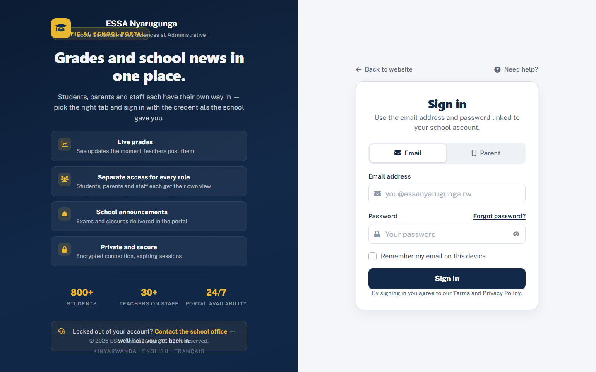
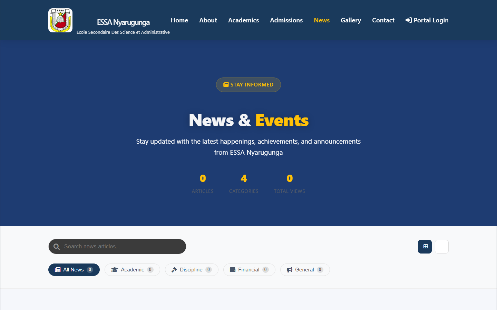
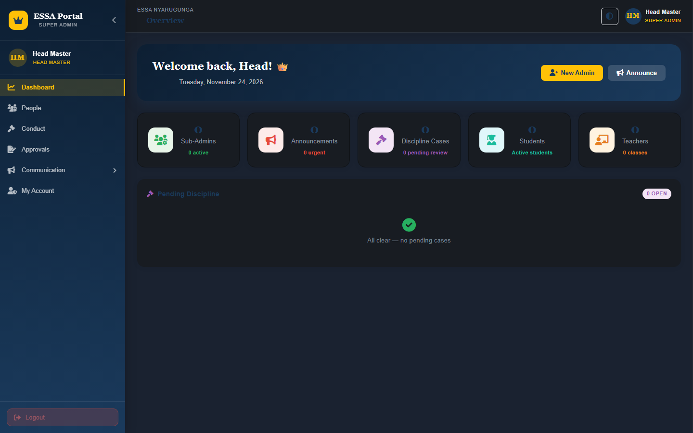

# ESSA Nyarugunga School Management System

A focused web platform for **ESSA Nyarugunga** that brings the school's public website and internal administration into one system. The public side presents the school, its programmes, admissions, news and gallery. The private side provides eight role-specific portals with server-enforced access control.

The current build is deliberately essential-only: admissions, academics, discipline, finance, registration, communication and website content. It does **not** include quizzes, attendance, timetables, lesson plans, analytics dashboards, calendars/events, report cards, promotion/enrollment workflows, SDMS codes, permission slips, subscriptions/newsletters, chat, push notifications, SMS, payroll, or parent online payment.

---

## Screenshots

Captured from the running local application after the database reset, so empty counters on the dashboard are expected.

| Public website | Portal sign-in |
| --- | --- |
|  |  |

| About ESSA | Academic programmes |
| --- | --- |
|  |  |

| Admissions | News |
| --- | --- |
|  |  |

### Headmaster portal



---

## What the system does

### Public website

- Responsive home, about, academics, admissions, news, gallery and contact pages.
- Online admission application form with duplicate detection.
- News and gallery items drawn from published CMS records only.
- Privacy, terms, accessibility, sitemap and search pages.

### Eight role portals

| Role | Portal route | Primary responsibilities |
| --- | --- | --- |
| Headmaster | `/portal/headmaster` | Final admission decisions, staff oversight, whole-school visibility, announcements |
| Academic Administrator | `/portal/academic-admin` | Classes, subjects, teacher allocation, exams, final result review and publication |
| Discipline Administrator | `/portal/discipline-admin` | Discipline records, conduct follow-up and parent notification |
| Accounts Administrator | `/portal/accounts-admin` | Fee structures, invoices, payments, expenses and budgets |
| Admin Assistant | `/portal/admin-assistant` | Application review, registration, student/parent/staff records, documents |
| Teacher | `/portal/teacher` | Enter marks for assigned subjects/classes, assignments, resources and class notices |
| Parent | `/portal/parent` | View only linked and verified children's grades, fees, discipline and documents |
| Student | `/portal/student` | View only their own grades, fees, assignments and announcements |

`super_admin` remains as a compatibility alias for `headmaster` in both role configurations. It is not a ninth role.

### Website content management

There is no standalone CMS route. The shared content editor is embedded only in dashboards whose role is authorized to manage content.

- Categories: `academic`, `discipline`, `financial`, `general`.
- Lifecycle: `draft` → `scheduled` → `published`.
- Scheduled items become public automatically when their publish time arrives.
- Category ownership is checked on the backend before create, edit, delete or status changes.

### Admissions

- Public application submission.
- Duplicate detection by email, phone and verified national/ID number.
- Status flow: `submitted` → `under_review` → `approved` / `rejected` → `registered`.
- `registered` can only be set through the dedicated registration endpoint after approval; it cannot be chosen directly in the status workflow.
- Admin Assistants review and register; the Headmaster makes final approval and rejection decisions.

### Academics and results

- Teachers enter marks for their assigned classes and subjects.
- Academic Administrators review and publish final results.
- Students and parents see only records they are authorized to see.
- Assignments, class resources and announcements remain available to teachers.

### Notifications

- Delivery channels: **in-app notifications and email only**.
- No push, SMS, chat or newsletter delivery.
- Notification preferences are per user and cover the canonical backend notification types.
- Schedulers publish due website content, release due announcements and send assignment/exam reminders.

---

## Security model

- Role definitions are mirrored in `frontend/src/config/roles.js` and `backend/config/roles.js`.
- Frontend guards hide irrelevant navigation, but **hidden navigation is not the security boundary**. Every privileged endpoint is checked again by backend middleware using the authenticated user's role.
- Teacher data is scoped by class and subject allocation.
- Parent data is scoped to linked, verified children.
- Student data is scoped to the authenticated student's own records.
- JWT authentication, rate limiting, Helmet security headers and CORS origin allowlisting are enabled.
- First-time/generated account passwords require a password change before portal access.

---

## Technology stack

**Frontend:** React 19, Vite 8, React Router, Axios, SweetAlert2  
**Backend:** Node.js, Express, MongoDB/Mongoose, JWT, Nodemailer, Multer  
**Delivery:** In-app notifications + SMTP email; local uploads served from `/uploads`

---

## Deployed application

| Service | Live URL |
| --- | --- |
| Frontend (Vercel) | <https://essa-nyarugunga-school-complex-syst-eta.vercel.app/> |
| Backend API (Render) | <https://essa-api.onrender.com/> |

Production builds use a single API base defined in `frontend/src/config/api.js`. It resolves to the Render URL automatically; a stale `VITE_API_URL` pointing at `localhost` is ignored in production builds. The backend allows the live Vercel origin (and this project's Vercel preview URLs) through CORS even when `FRONTEND_URL` is unset.

Recommended dashboard variables:

| Platform | Variable | Value |
| --- | --- | --- |
| Vercel | `VITE_API_URL` | `https://essa-api.onrender.com` (or leave unset) |
| Render | `FRONTEND_URL` | `https://essa-nyarugunga-school-complex-syst-eta.vercel.app` |
| Render | `JWT_SECRET` | Long random secret |
| Render | `MONGODB_URI` | Production MongoDB connection string |
| Render | `EMAIL_USER` / `EMAIL_PASS` | SMTP credentials for notification emails |

Both `vercel.json` files include the SPA rewrite so direct links such as `/portal/headmaster` and `/set-password` serve `index.html` instead of a 404. If your Vercel project uses `frontend` as its Root Directory, `frontend/vercel.json` is used; otherwise the root `vercel.json` builds and serves `frontend/dist`.

---

## Project structure

```text
backend/
  config/          Database, roles, rate limits, upload settings
  models/          Mongoose schemas
  routes/          Public and role-scoped API routes
  utils/           Notifications, email, schedulers and access helpers
  scripts/         Explicit database reset script
frontend/
  public/          Static assets
  src/
    components/    Shared UI, navigation and notifications
    config/        Role and permission definitions
    pages/         Public website pages
    portals/       Eight role dashboards and shared panels
    utils/         Small browser helpers
docs/screenshots/  Real screenshots of the running application
```

---

## Getting started

### Prerequisites

- Node.js 20.19+ (required by Vite 8)
- MongoDB running locally or a reachable MongoDB URI
- npm
- SMTP credentials if you want email delivery to work

### 1. Install dependencies

```bash
cd backend
npm install

cd ../frontend
npm install
```

### 2. Configure environment

```bash
cp backend/.env.example backend/.env
cp frontend/.env.example frontend/.env
```

Update `backend/.env` with your MongoDB URI, JWT secret, frontend URL and SMTP credentials. The checked-in defaults use:

```text
Backend API:  http://localhost:5001
Frontend:     http://localhost:5174
Database:     mongodb://127.0.0.1:27017/essa_school
```

`FRONTEND_URL` and `VITE_API_URL` must match the URLs you actually open. Email delivery needs valid SMTP credentials; the rest of the system still runs without them.

### 3. Start the services

In one terminal:

```bash
cd backend
npm run dev
```

In another terminal:

```bash
cd frontend
npm run dev
```

Open <http://localhost:5174>.

### 4. First login

```text
Email:    admin@essa.rw
Password: admin123
```

This is the only account created by the fresh reset. Create the other seven roles from the Headmaster and Admin Assistant dashboards.

---

## Resetting the local database

The reset is intentionally explicit and must never be called from application startup.

> **Warning:** this drops every collection and permanently deletes all local records.

From the `backend/` directory, with MongoDB running:

```bash
node scripts/resetDatabase.js
```

After a successful reset, the only user is:

```text
admin@essa.rw / admin123
```

Restart the backend after resetting so in-memory scheduler state is clean.

---

## Verification

```bash
# Frontend production build
cd frontend
npm run build

# Backend syntax check (all JS files)
cd ../backend
node --check server.js
```

The current local verification also confirms that signing in as `admin@essa.rw / admin123` redirects to `/portal/headmaster`.

---

## Notes for maintainers

- Keep `backend/config/roles.js` and `frontend/src/config/roles.js` aligned. The backend map is authoritative for access control.
- Preserve `ROLE_ALIASES = Object.freeze({ super_admin: ROLES.HEADMASTER })` for stored legacy records.
- Admission status transitions belong in `backend/routes/admissionsAdminRoutes.js`; do not allow clients to set `registered` directly.
- Website content must stay embedded in authorized dashboards; do not reintroduce a standalone CMS route.
- The local pre-refactor backup directory is ignored by Git and must never be committed.
