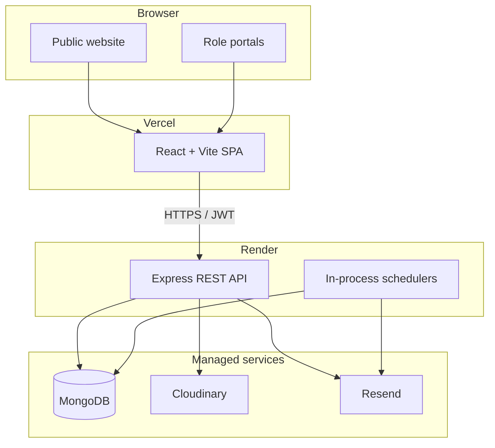

# Architecture

## Purpose

ESSA Nyarugunga School Management System combines a public school website with eight private role portals. The architecture is deliberately small: a React SPA, an Express API, MongoDB, Cloudinary for uploads and Resend for email.

The system is **essentials-only**. The architecture document describes what exists today, not a roadmap.

## System topology



## Frontend

- **Framework:** React 19 with Vite 8.
- **Routing:** React Router 7. Public routes and role portals share the same SPA.
- **API base:** `frontend/src/config/api.js` resolves the backend URL. Production defaults to the Render API; local development defaults to `http://localhost:5001`.
- **Role configuration:** `frontend/src/config/roles.js` mirrors the backend role map and defines routes and permissions.
- **Authorization:** `ProtectedRoute` and portal components hide navigation the current role cannot use, but the backend remains authoritative.
- **Deployment:** Vercel builds `frontend/dist`. The checked-in `vercel.json` files rewrite unknown paths to `index.html` for client-side routing.

## Backend

- **Framework:** Express 4 on Node.js 20+.
- **Database:** MongoDB through Mongoose.
- **Authentication:** JWT Bearer tokens. Passwords are hashed with bcryptjs.
- **Authorization:** Middleware verifies the token and required role. Route handlers then enforce ownership and scope.
- **API paths:** All application endpoints live under `/api`. `GET /` returns a status summary and `GET /api/health` is the health check.
- **Proxy handling:** `app.set('trust proxy', 1)` matches Render's single proxy hop and lets rate limiting read the forwarded client IP.

### Request lifecycle

1. A request reaches Express through Render's proxy.
2. Helmet sets security headers.
3. CORS checks the origin against the allowlist.
4. JSON/urlencoded body parsing runs.
5. `/api` rate limiting applies.
6. Route-specific middleware authenticates the JWT and checks the role.
7. The handler validates ownership and carries out the database operation.
8. Errors are normalized by the shared error handler.

## Role model

Exactly eight roles are supported:

| Role | Boundary |
| --- | --- |
| `headmaster` | Whole-school oversight and final admission decisions |
| `academic_admin` | Classes, subjects, allocation, exams and result publication |
| `discipline_admin` | Discipline records and conduct follow-up |
| `accounts_admin` | Fees, invoices, payments, expenses and budgets |
| `admin_assistant` | Application review, registration and student/parent/staff records |
| `teacher` | Assigned classes/subjects, marks, assignments and resources |
| `parent` | Linked, verified children only |
| `student` | Own records only |

`super_admin` is a stored-data compatibility alias for `headmaster`. It is not a ninth role.

### Critical invariants

- Frontend navigation is convenience, not security.
- Every privileged endpoint checks the authenticated user's role server-side.
- Teachers are limited to assigned classes and subjects.
- Parents are limited to linked, verified children.
- Students are limited to their own records.
- Finance, exam, discipline, admissions and registration duties stay separated.
- The Headmaster makes final admission decisions; the Admin Assistant reviews and registers.
- Website content management stays embedded in authorized dashboards.
- Removed features stay removed.

## Admissions

```text
submitted
  -> under_review
  -> approved | rejected
  -> registered   (dedicated registration endpoint only)
```

- Public applicants submit the admission form.
- Duplicate detection checks email, phone and national/ID number.
- Reviewers cannot jump directly to `registered`.
- Registration is a separate, approved-only action.
- Applicant email updates do not include internal review notes.

## Website content

- Categories: `academic`, `discipline`, `financial`, `general`.
- Lifecycle: `draft` -> `scheduled` -> `published`.
- Category ownership is checked server-side for create, update, delete and status changes.
- Public endpoints only return content whose publish time has arrived.
- A scheduler promotes due scheduled content.

## Uploads

All upload surfaces use `backend/utils/storage.js`:

- Multer receives files in memory.
- File type and size checks run before storage.
- The storage adapter writes to the configured provider:
  - `cloudinary` in production.
  - `local` for development fallback.
  - `s3` is supported by the adapter but not the recommended production path for this deployment.
- News, gallery, profile, assignment, submission and class-resource uploads all use this adapter.
- Local disk is ephemeral on Render, so production must use Cloudinary or another durable provider.

## Notifications

- Channels: **in-app and email only**.
- In-app records live in MongoDB.
- Resend delivers transactional email.
- Notification preferences are stored per user.
- Schedulers release due announcements and send assignment/exam reminders.
- There is no chat, push notification, SMS or newsletter provider.

## Schedulers

The API process starts three in-process schedulers:

- Announcement release.
- Website content publishing.
- Assignment/exam reminders.

These assume a single application instance. If the deployment is scaled horizontally, move schedulers into a dedicated worker or add a distributed lock.

## Deployment

- **Frontend:** Vercel.
- **API:** Render.
- **Database:** MongoDB Atlas or another managed MongoDB instance.
- **Uploads:** Cloudinary.
- **Email:** Resend.

See [DEPLOYMENT.md](DEPLOYMENT.md) for the operational steps.

## Operational notes

- Render's local filesystem is not durable. Uploaded files must use Cloudinary.
- Resend requires a verified sender domain for production delivery.
- A stale `VITE_API_URL` pointing at localhost is ignored in production builds.
- CORS allows the production Vercel origin, this project's preview URLs and local development origins.
- The API should be treated as stateless; all durable state belongs in MongoDB or Cloudinary.
